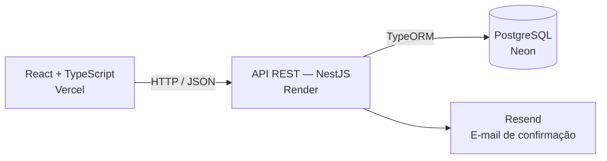

# Alva Modas

**E-commerce Full Stack demonstrativo de moda feminina.**

Desenvolvido para apresentar uma experiência de compra integrada, desde a navegação pelo catálogo até o registro do pedido e o envio de confirmação por e-mail.

O projeto reúne interface responsiva, API REST, autenticação de clientes e persistência em PostgreSQL, com organização modular e testes automatizados.

**[Acessar a loja →](https://alva-modas.vercel.app/)**

> Projeto desenvolvido para estudo, portfólio e demonstração técnica. Não realiza cobranças ou entregas reais. Este README descreve a versão estável da branch `main`.

## Tecnologias

| Camada | Tecnologias |
|---|---|
| Frontend | React, TypeScript, Vite e Tailwind CSS |
| Navegação e dados | React Router e TanStack Query |
| Formulários | React Hook Form e Zod |
| Backend | NestJS, TypeScript e TypeORM |
| Banco de dados | PostgreSQL, hospedado no Neon |
| Autenticação | JWT em cookie HttpOnly e senhas protegidas com Argon2id |
| E-mails | Resend, com suporte adicional a SMTP |
| Documentação da API | Swagger |
| Testes | Vitest, Testing Library, Jest e Supertest |
| Hospedagem | Vercel para o frontend e Render para o backend |

## Funcionalidades

- **Catálogo de produtos:** listagem integrada à API, com imagens, descrições, categorias, preços e disponibilidade.
- **Busca e filtros:** pesquisa por nome ou descrição e filtragem por categoria.
- **Carrinho de compras:** inclusão e remoção de produtos, ajuste de quantidades e apresentação dos totais.
- **Validação de estoque:** conferência de disponibilidade e limites das quantidades no backend.
- **Cadastro e autenticação:** criação de conta, login, consulta da sessão e logout.
- **Compra como visitante:** finalização sem obrigatoriedade de cadastro.
- **Checkout demonstrativo:** validação dos dados do cliente e revisão dos itens.
- **Registro de pedidos:** gravação do pedido e dos itens, com atualização de estoque em uma transação.
- **Confirmação por e-mail:** integração com a Resend após o registro do pedido.
- **Interface responsiva:** adaptação para dispositivos móveis e desktop.

## Arquitetura

O projeto utiliza um monorepositório com frontend e backend independentes.



O frontend apresenta os produtos e gerencia a interação com os formulários e o carrinho. O backend centraliza as regras de negócio, a autenticação, a validação de estoque e o registro dos pedidos.

Produtos, clientes, pedidos e itens são persistidos no PostgreSQL. Os itens do pedido preservam as informações da compra, como nome do produto e preço unitário.

### Estrutura de pastas

```text
alva-modas/
├── frontend/
│   ├── src/
│   │   ├── assets/          # Imagens e recursos visuais
│   │   ├── components/      # Componentes da interface
│   │   ├── contexts/        # Contextos de autenticação e carrinho
│   │   ├── hooks/           # Hooks e lógica de interação
│   │   ├── pages/           # Páginas da aplicação
│   │   ├── providers/       # Providers compartilhados
│   │   ├── services/        # Comunicação com a API
│   │   ├── test/            # Testes do frontend
│   │   └── types/           # Tipos e schemas de validação
│   └── scripts/            # Verificações de configuração
├── backend/
│   ├── src/
│   │   ├── auth/           # Cadastro e autenticação
│   │   ├── carrinho/       # Operações e regras do carrinho
│   │   ├── config/         # Configuração do ambiente
│   │   ├── database/       # Migrations e seed de produtos
│   │   ├── email/          # Integração e templates de e-mail
│   │   ├── finalizar-compra/
│   │   ├── pedidos/        # Entidades de pedidos e itens
│   │   └── produtos/       # Catálogo e entidades de produtos
│   └── test/               # Testes HTTP e de integração
├── deploy/                 # Documentação de implantação
└── render.yaml             # Configuração de infraestrutura
```

## Executar localmente

### Pré-requisitos

- Node.js **24.x**, a partir da versão **24.15.0**.
- npm.
- PostgreSQL **13 ou superior**.
- Git.

A versão de Node utilizada no projeto está definida em [`.nvmrc`](.nvmrc).

### 1. Clonar a versão estável

```bash
git clone --branch main https://github.com/lari-dias/alva-modas.git
cd alva-modas
```

### 2. Instalar as dependências

Na pasta `backend`:

```bash
npm ci
```

Na pasta `frontend`:

```bash
npm ci
```

### 3. Configurar o ambiente

Copie os modelos para os arquivos locais, caso eles ainda não existam:

| Modelo | Arquivo local |
|---|---|
| `backend/.env.example` | `backend/.env` |
| `frontend/.env.example` | `frontend/.env.local` |

Crie um banco PostgreSQL exclusivo para desenvolvimento e configure no `backend/.env`:

- `DB_HOST`, `DB_PORT` e `DB_DATABASE`.
- `DB_USERNAME` e `DB_PASSWORD`.
- `JWT_SECRET`: segredo aleatório exclusivo, com pelo menos 32 caracteres.
- `CHECKOUT_ADMIN_TOKEN`: outro segredo aleatório exclusivo, com pelo menos 32 caracteres, para abrir e pausar o checkout local.
- `FRONTEND_URL=http://localhost:5173`.
- `JWT_COOKIE_SECURE=false` para desenvolvimento local em HTTP.

Para gerar o segredo JWT localmente:

```bash
node -e "console.log(require('node:crypto').randomBytes(48).toString('base64url'))"
```

No `frontend/.env.local`, configure:

```dotenv
VITE_API_URL=http://localhost:3000
```

Use `localhost` tanto para abrir o frontend quanto para configurar a API, mantendo o comportamento esperado do cookie de sessão.

Os arquivos `.env` reais devem permanecer fora do Git.

### 4. Preparar o banco

Na pasta `backend`, com a conexão de desenvolvimento configurada:

```bash
npm run migration:run
npm run seed:produtos
```

O seed cadastra o catálogo demonstrativo com 12 produtos. Ele é executado separadamente e preserva os produtos já existentes.

### 5. Iniciar a aplicação

Em um terminal, na pasta `backend`:

```bash
npm run start:dev
```

Em outro terminal, na pasta `frontend`:

```bash
npm run dev
```

| Serviço | Endereço local |
|---|---|
| Loja | http://localhost:5173 |
| API | http://localhost:3000 |
| Swagger | http://localhost:3000/api/docs |

As migrations deixam o checkout fechado. Com a API local em execução, abra outro terminal na pasta `backend` e libere somente seu banco de desenvolvimento:

```powershell
node --env-file=.env scripts/checkout-control.mjs pause
node --env-file=.env scripts/checkout-control.mjs open
```

O modelo `.env.example` define `NODE_ENV=development` e `CHECKOUT_CONTROL_URL=http://localhost:3000`. O token administrativo deve estar preenchido no `.env`; não o envie ao frontend. Para produção, siga o [roteiro de implantação e recuperação](deploy/CHECKOUT-RECOVERY.md), que exige migrations e configuração autorizadas separadamente.

### E-mails em desenvolvimento

A aplicação pode ser executada localmente com `CHECKOUT_OUTBOX_ENABLED=false` e sem configurar um provedor. Nesse cenário, os pedidos são registrados e os eventos de e-mail permanecem pendentes, sem envio externo.

Para testar a integração, configure `CHECKOUT_OUTBOX_ENABLED=true`, `RESEND_API_KEY` e `RESEND_FROM` no backend e utilize destinatários controlados. Também é possível utilizar SMTP de desenvolvimento; envios incertos por SMTP exigem revisão, sem repetição automática.

## Testes e builds

Execute os comandos na pasta correspondente:

| Verificação | Frontend | Backend |
|---|---|---|
| Testes | `npm test` | `npm test -- --runInBand` |
| Testes HTTP | — | `npm run test:e2e -- --runInBand` |
| Build | `npm run build` | `npm run build` |
| Lint | `npm run lint` | `npm run lint` |
| TypeScript completo | `npm run typecheck` | `npm run typecheck` |

O lint verifica sem editar arquivos. Para aplicar correções do backend intencionalmente, use `npm run lint:fix`.

Os testes cobrem comportamentos do catálogo, carrinho, autenticação e checkout, além de validações e regras do backend.

## Sobre a demonstração

A Alva Modas é uma loja fictícia, desenvolvida para estudo e portfólio. Não processa pagamentos reais. Os pedidos de teste são registrados no banco de dados; utilize dados fictícios durante a demonstração.

## Documentação complementar

- [Frontend](frontend/README.md)
- [Backend e API](backend/README.md)
- [Configuração de implantação](deploy/README.md)

## Autoria

Desenvolvido por **Larissa Dias | Lari Dev**.

[GitHub](https://github.com/lari-dias) · [LinkedIn](https://www.linkedin.com/in/alarissa-dias/)
